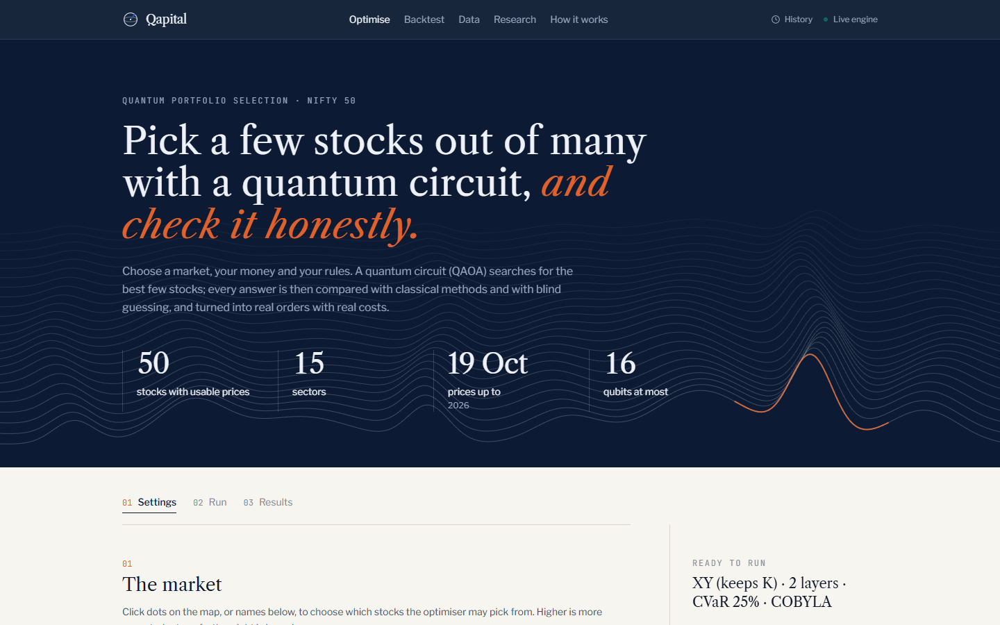
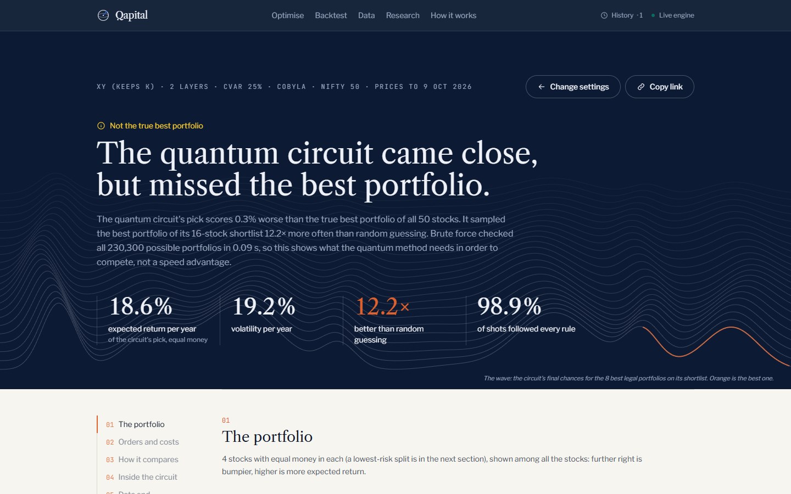
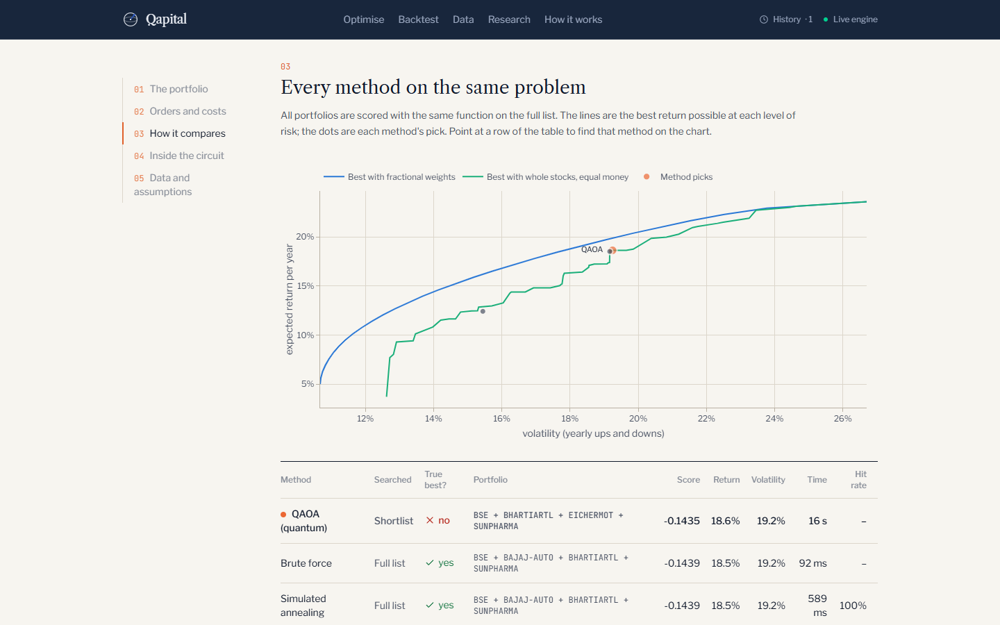
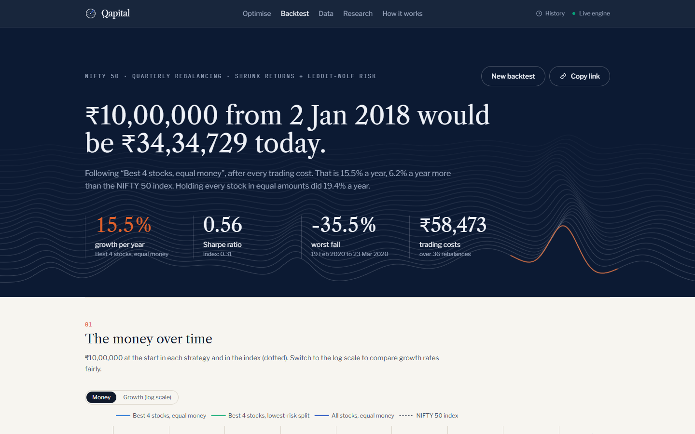
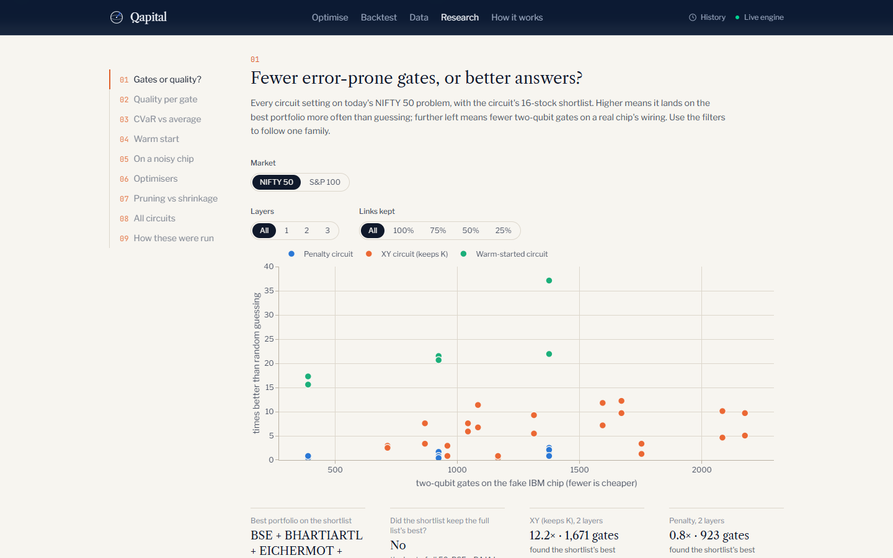

# Qapital

**Quantum portfolio selection on real market data, checked honestly against classical methods.**

Pick a few stocks out of the NIFTY 50 or the S&P 100 with a quantum algorithm (QAOA, simulated with Qiskit), then see
how it compares with classical optimisers and blind guessing, what whole-share orders it would place with real trading
costs, and how the strategy would have done since 2018.

**Try it: [qapital-dun.vercel.app](https://qapital-dun.vercel.app)** · API docs:
[sameeksha15--qapital-api.modal.run/docs](https://sameeksha15--qapital-api.modal.run/docs)

The engine sleeps when nobody is using it, so the first run after a quiet spell waits while it starts; the site shows
saved runs meanwhile.



| | |
|---|---|
|  |  |
| A result, honest when the circuit misses the best portfolio | Every method on the same problem, against the efficient frontier |
|  |  |
| A walk-forward backtest since 2018, after trading costs | Research: two-qubit gates against quality for every circuit |

## What it does

- **Real data, refreshed nightly.** A scheduled job downloads daily prices for both stock lists, checks them, and
  publishes a dated, fingerprinted snapshot. Every result says which snapshot it used.
- **A real investor's problem.** Choose the market, the stocks, your cash and the shares you already own. Expected
  returns use Bayes-Stein shrinkage and risk uses Ledoit-Wolf; trading costs come from cited rate cards (Zerodha's for
  NSE, SEC and FINRA fees for US stocks), so keeping a stock you own is cheaper than buying a new one.
- **Three quantum circuits.** The textbook penalty circuit; an XY-mixer circuit that keeps the stock count fixed by
  construction, so every shot is legal; and a warm-started circuit that begins near a classical relaxation's answer.
  Each can be tuned for its best 25% of outcomes (CVaR) instead of the average, pruned to its strongest stock links,
  and run on the noise model of a real IBM chip with readout mitigation.
- **An honest comparison.** Every answer is scored with one shared function and compared with the proven best (brute
  force, when the list allows), simulated annealing, a convex relaxation, and random guessing with the same number of
  tries. When there are too many portfolios to check, the result says the best is "best known", not proven.
- **Orders and a backtest.** The chosen portfolio becomes whole-share orders with every charge itemised, and a
  walk-forward backtest replays the strategy since 2018 using only the prices known at each rebalance.

## What the research found

Every experiment ran on the problem the app would have solved at the start of each quarter since 2019, in both
markets (64 problems), so each finding is a spread over many real problems rather than one lucky case. The raw runs
and exact settings are in [`research/results/`](research/results/).

| Question | Result |
|---|---|
| Does tuning for the best 25% of shots (CVaR) beat tuning for the average? | Yes: better on 58 of 64 problems (XY circuit, 2 layers). |
| Does a warm start help, and is the gain quantum? | The warm start alone was 4.5× better than guessing; after 2 quantum layers, 21.1×. The layers improved on their start in 64 of 64 problems. |
| Does the XY circuit need fewer gates than the penalty circuit for the same quality? | No. Matching the penalty circuit's best took about the same number of two-qubit gates (429 vs 428). XY's advantages are that every shot is legal and that it keeps improving past that point. |
| What survives a noisy IBM chip? | Little, raw: the XY circuit fell from 17× to 1.5× better than guessing. Readout mitigation plus discarding shots with the wrong stock count brought it back to 5×. |
| Pruning vs shrinking the risk model? | Ledoit-Wolf shrinkage was closest to the next year's real covariance on 39 of 56 problems. |

And the backtest, rebalanced quarterly from January 2018 to October 2026, after all trading costs:

| Strategy | NIFTY 50: growth / year | Sharpe | S&P 100: growth / year | Sharpe |
|---|---|---|---|---|
| Best 4 stocks, equal money | 15.5% | 0.56 | 10.0% | 0.45 |
| All stocks, equal money | 19.4% | 0.82 | 19.0% | 0.88 |
| Index | 9.3% | 0.31 | 12.9% | 0.60 |

Picking four stocks beat the NIFTY 50 index but not an equal split of every stock, and it trailed the S&P 500. The
stock lists are today's index members, so all of these numbers are flattered by survivorship bias.

## What it doesn't claim

Classical methods solve these problem sizes in seconds on a laptop (exactly, when the list is small enough to check
every portfolio). The quantum circuits run on a simulator (16 qubits at
most, 12 with noise), and the project shows what the quantum method needs in order to compete, not a speed
advantage. Nothing here is investment advice.

## How it's built

```
pipeline/   nightly: official stock lists + yfinance prices → checked snapshot → GitHub release "data"
src/qapital/
  core/       the one score function, portfolio enumeration and counting, grading
  data/       stock lists, quality checks, snapshots (and downloading them in production)
  finance/    estimates, trading costs, whole-share orders, risk metrics, walk-forward backtests
  classical/  brute force, simulated annealing, relaxation, random guessing, efficient frontiers
  quantum/    Hamiltonians, circuits (penalty, XY, warm start), tuning, CVaR, noise and mitigation, IBM Runtime
  api/        FastAPI: jobs with live progress (server-sent events), result storage, rate limits
web/        React + TypeScript, React Router, TanStack Query, Plotly; API types generated from OpenAPI
research/   experiments over dated problems and their raw results
```

The API runs serverless on Modal (`deploy/modal`; a single-VM setup with Docker and Caddy is in `deploy/oracle`) and
keeps results in Postgres; the website is on Vercel and shows saved runs whenever the API is starting or can't be
reached. CI runs ruff, mypy and 180+ Python tests, the website's type check,
unit tests and browser smoke tests, and builds the Docker image. Every push to `main` that passes CI redeploys
the API; a nightly job publishes fresh prices, which the API picks up without a restart.

## Run it locally

Needs Python 3.12+, [uv](https://docs.astral.sh/uv/) and Node 22.

```bash
uv sync --extra api --extra pipeline --extra dev
uv run python -m pipeline.ingest                                   # download and check prices (a few minutes)
uv run uvicorn qapital.api.main:create_app --factory --reload      # API at http://localhost:8000/docs

cd web
npm ci
cp .env.example .env.local                                          # points the site at the local API
npm run dev                                                         # http://localhost:5173
```

Checks: `uv run pytest`, `uv run ruff check .`, `uv run mypy`, and in `web/`: `npm run typecheck`, `npm test`,
`npm run e2e`. The research: `uv run python -m research.experiments.run_all` (about 1.5 hours).

## Licence

[MIT](LICENSE).
